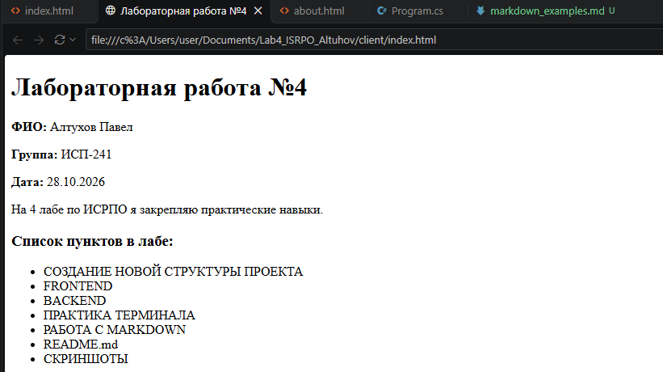
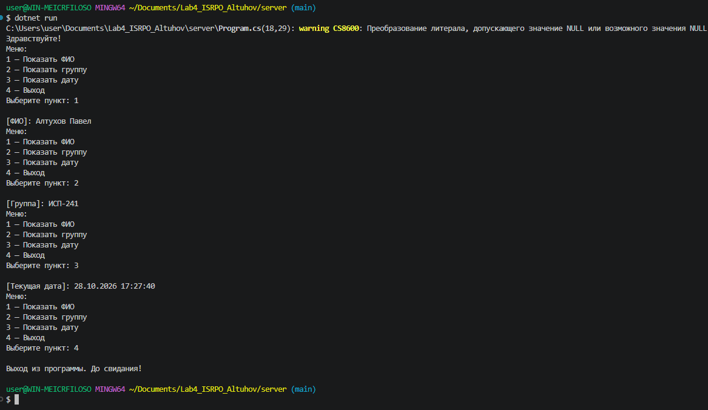

# Лабораторная работа №4. Закрепление навыков работы с Git, Markdown, терминалом и проектной структурой

**Исполнитель:** Алтухов Павел  
**Группа:** ИСП-241  
**Дата выполнения:** 28.10.2026  

## Описание проекта
Данный проект направлен на комплексное повторение ранее изученых тем. В рамках лабораторной работы была реализована кроссплатформенная структура, включающая статический веб-интерфейс, консольное управляющее приложение на языке C#, а также структурированные разделы для практики в командной строке и написания технической документации.

## Содержание
1. [Структура проекта](#структура-проекта)
2. [Примеры Markdown](#примеры-markdown)
3. [Примеры LaTeX](#примеры-latex)
4. [Скриншоты работы](#скриншоты-работы)
5. [Заключение](#заключение)

## Структура проекта
Проект имеет следующую архитектуру каталогов:
* `client/` — файлы статического фронтенда (`index.html`, `about.html`)
* `docs/` — примеры документирования на Markdown и LaTeX
* `repo/` — графические скриншоты верификации выполнения задач
* `server/` — консольный проект на C#
* `terminal_practice/` — рабочая область для выполнения консольных команд управления файлами

## Примеры Markdown
### Список компонентов
* Консоль терминала
* Текстовые разметки
### Демонстрационный код
```csharp
Console.WriteLine("ФИО: Алтухов Павел");
```

## Примеры LaTeX
* **Встроенный вид:**  $y = kx + b$
* **Блочный вид:**
$$
f(x) = \int_{-\infty}^{\infty} e^{-x^2} dx
$$

## Ссылки
* [Официальный репозиторий проекта](https://github.com/youngest0daughter/Lab4_ISRPO_Altuhov)

## Скриншоты работы
### Веб-интерфейс проекта (index.html)


### Работа программы Backend


### Структура терминала


## Заключение
В процессе работы были выполнены следующие задачи:
* Развернута правильная структура проекта исключительно через командную строку.
* Реализована базовая Frontend-часть на HTML и Backend-приложение на платформе .NET (C#).
* Отработаны основные операции с файлами и папками в терминале.
* Продемонстрировано владение расширенным синтаксисом разметки Markdown и математических формул LaTeX.
