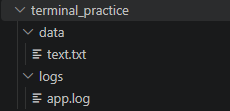

# Сведения о работе
* **ФИО:** Алтухов Павел
* **Группа:** ИСП-241
* **Дата:** 28.10.2026

# Заголовок H1
## Заголовок H2
### Заголовок H3
#### Заголовок H4
##### Заголовок H5
###### Заголовок H6

---

## Форматирование текста
**жирный текст**, *курсивный текст*, ~~зачёркнутый текст~~, `моноширинный текст`.

## Списки
### Маркированный список
* A
* B

### Нумерованный список
1. A
2. B

### Вложенный список
* A
  * A.A
    * A.A.A
    * A.A.B
  * A.B
    * A.B.A

## Цитаты
> Брат уйдёт от брата только если звонок на пару.

## Блоки кода
```bash
git status
```

## Таблица

| Компонент | Назначение | Версия |
| :--- | :--- | :--- |
| Frontend | Клиентский веб-интерфейс | HTML5 |
| Backend | Консольное серверное ядро | .NET 8.0 |
| Docs | Документация проекта | Markdown |

## Картинка из папки repo


## Ссылки
* [Внешняя ссылка на GitHub](https://github.com/youngest0daughter/Lab4_ISRPO_Altuhov)
* [Внутренняя ссылка на файл "Обо мне"](../client/about.html)

## Чекбоксы
- [x] Сделано
- [ ] Не сделано

## Alert-блок
> [!NOTE]
> Важное уведомление!

## Inline LaTeX
$a^2 + b^2 = c^2$

## Block LaTeX
$$
\sum_{i=1}^n i = \frac{n(n+1)}{2}
$$
